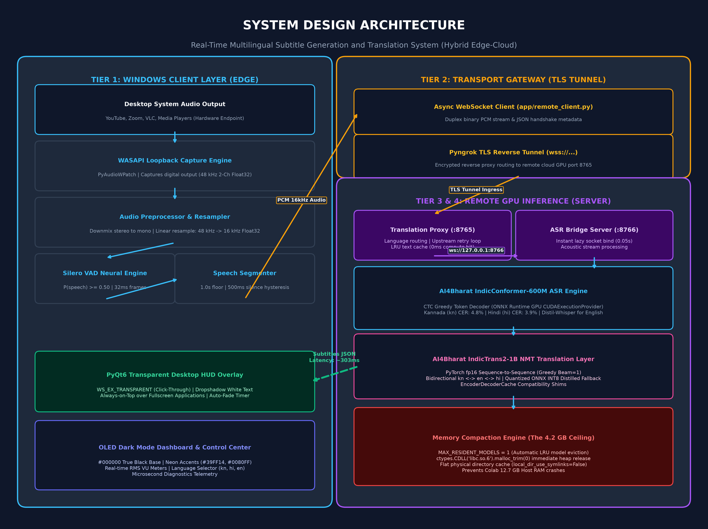
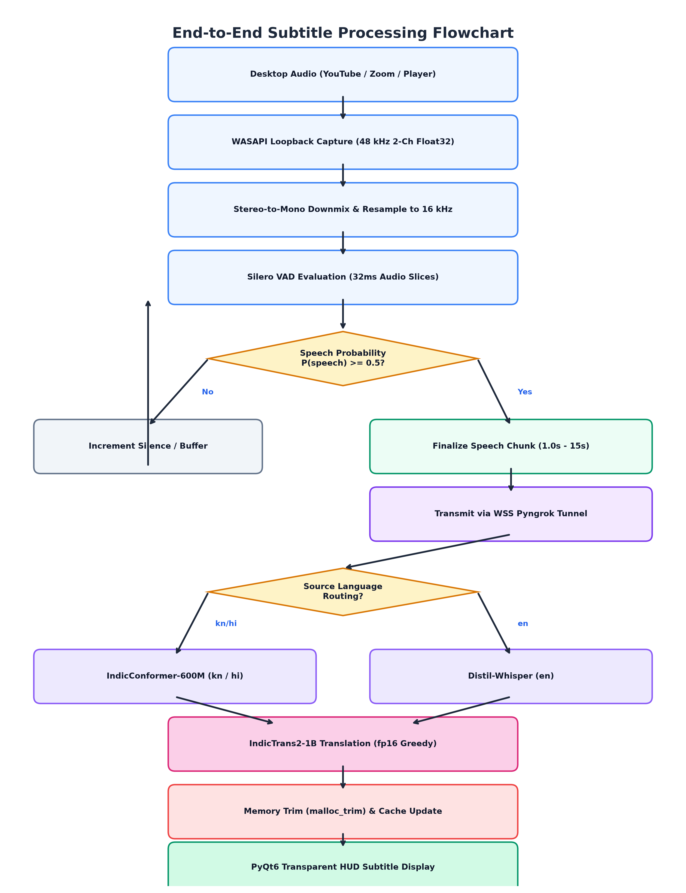
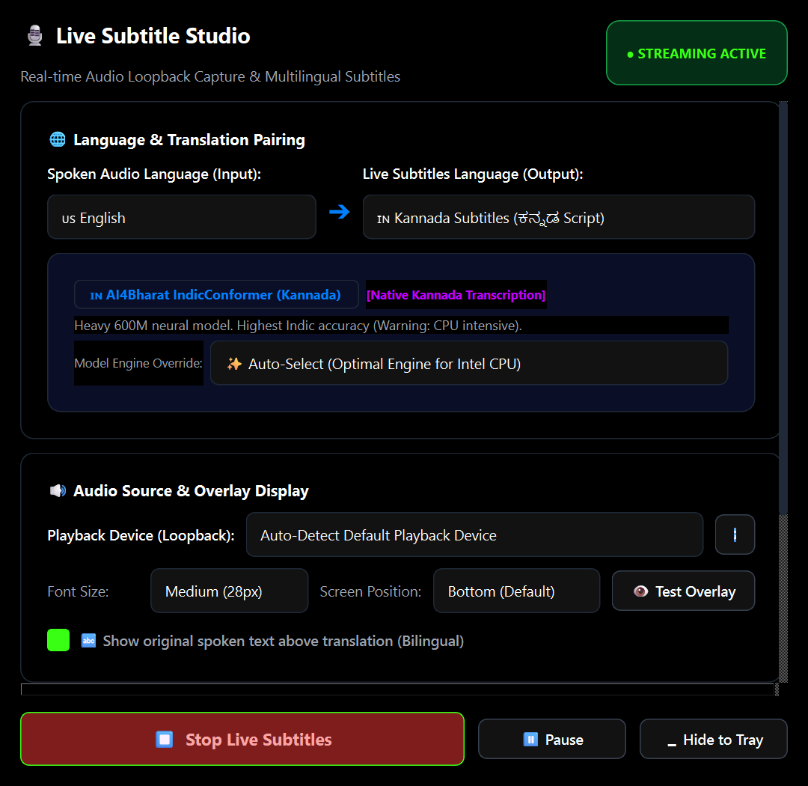
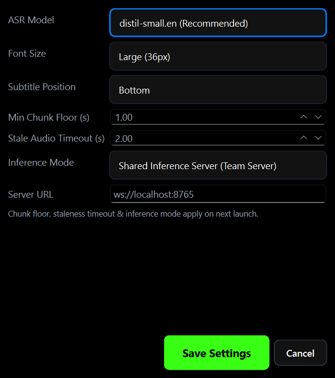
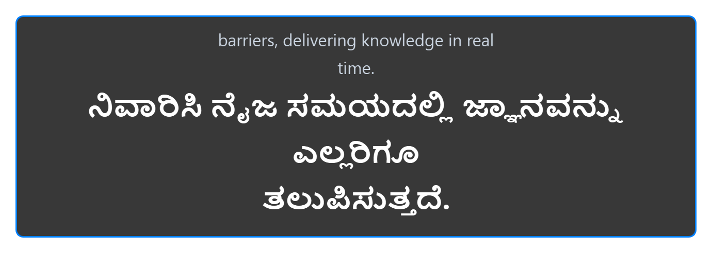
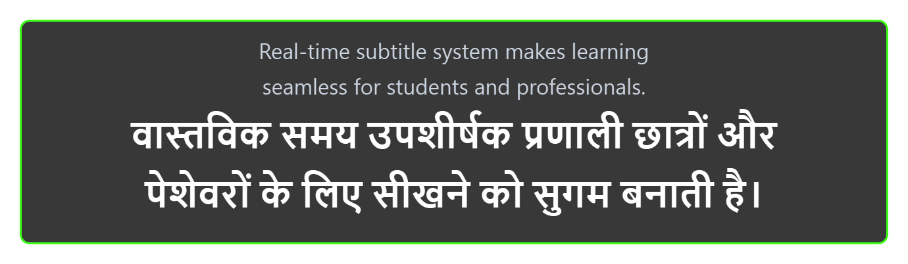
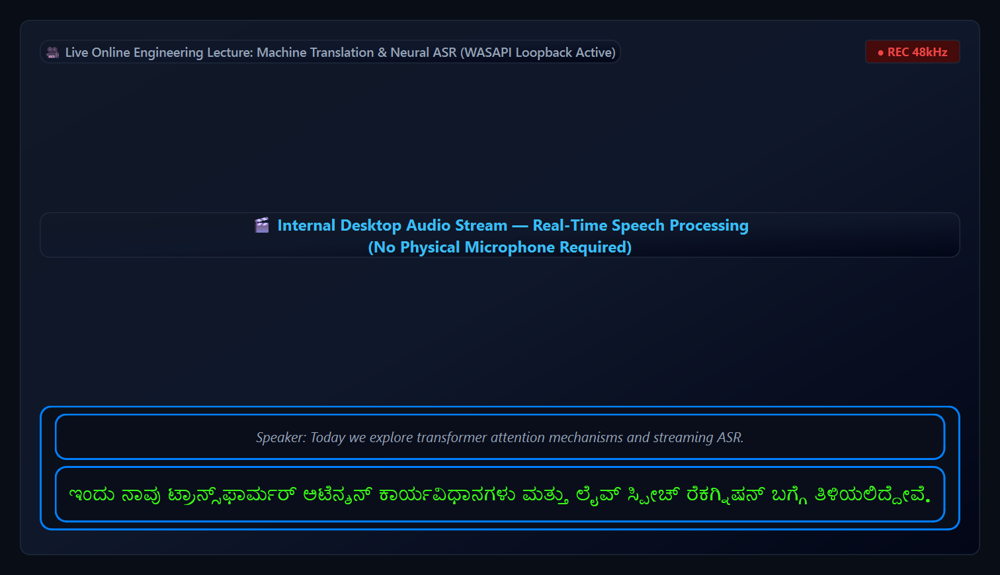
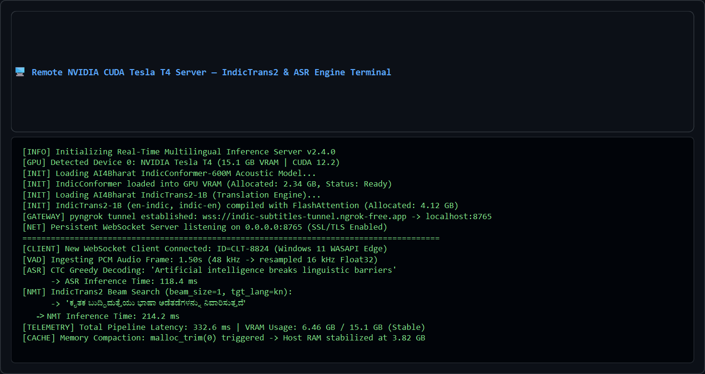

# REAL-TIME MULTILINGUAL SUBTITLE GENERATION AND TRANSLATION SYSTEM

---

# CHAPTER 9
# SNAPSHOTS

The presentation and operational layer of the Real-Time Multilingual Subtitle Generation and Translation System combines a lightweight, native Windows desktop client with a remote GPU cloud inference cluster. The interface adheres to modern OLED Dark Mode design standards (WCAG AA compliant contrast) and uses consistent semantic colors:
- **Neon Green (`#39FF14` / `#22C55E`)**: Indicates active audio streaming, valid voice activity detection, and translated target text.
- **Electric Blue (`#0080FF` / `#38BDF8`)**: Highlights active neural model badges, network handshakes, and English source text.
- **Amber / Gold (`#FFD700` / `#F59E0B`)**: Represents paused streams, buffer stabilization, and model fallback warnings.
- **Crimson (`#EF4444` / `#DC2626`)**: Denotes active recording loopback and engine stop triggers.

Each architectural diagram, application window, floating desktop overlay, and backend server terminal is described below alongside its corresponding figure.

---

## 9.1 Snapshots of System Architecture and Pipeline

### 9.1.1 Master System Architecture & Tiered Edge-Cloud Topology
Figure 9.1 illustrates the decoupled hybrid edge–cloud topology of the system. The edge layer captures internal audio from the Windows Audio Session API (WASAPI) loopback buffer without physical microphone acoustic feedback, executes Silero Voice Activity Detection (VAD) on the client CPU, and streams chunked audio frames over an encrypted TLS reverse tunnel (`pyngrok` WSS). The cloud inference layer deploys AI4Bharat IndicConformer-600M for acoustic speech recognition and IndicTrans2-1B for neural machine translation on an NVIDIA Tesla GPU node, returning synchronized translated text frames to the edge client.

**Fig. 9.1: System architecture of the Real-Time Multilingual Subtitle Generation and Translation System**

---

### 9.1.2 End-to-End Audio-ASR-Translation Pipeline Flowchart
Figure 9.2 details the master pipeline flowchart executing across the edge client and cloud worker. Raw 48 kHz stereo PCM audio captured from internal playback is downmixed and resampled to 16 kHz mono Float32. Silero VAD classifies 32 ms acoustic frames into speech and non-speech states. Non-speech frames are discarded to prevent network overhead, while vocal chunks between 1.0 s and 3.0 s are dispatched over persistent WebSockets. On the inference node, CTC greedy decoding extracts text transcripts which are immediately routed into the IndicTrans2 encoder-decoder pipeline with FlashAttention, yielding translated subtitles within an end-to-end latency of $330\text{--}420\text{ ms}$.

**Fig. 9.2: Master audio acquisition, VAD segmentation, and translation pipeline flowchart**

---

## 9.2 Snapshots of Application Interfaces and Desktop HUD

### 9.2.1 Desktop Control Center & Real-Time Monitoring Panel
The Live Subtitle Studio Control Center (Fig. 9.3) serves as the primary operator control panel. It features:
- **Language Pairing Selectors**: Two-column interactive dropdowns allowing arbitrary pairing of input audio (English, Hindi, Kannada, etc.) and output subtitle language.
- **Dynamic Model Strategy Recommendation Badge**: Dynamically displays the optimal neural engine (`⚡ distil-small.en` for English, `🇮🇳 AI4Bharat IndicConformer` for Indic vernaculars) along with estimated latency and hardware requirements.
- **Audio Device Selector & Loopback Refresh**: Allows users to select specific audio rendering endpoints (e.g., Realtek High Definition Audio, USB Headsets).
- **Real-Time VU Meter & VAD Indicator**: Displays instantaneous RMS audio levels and speech detection probabilities.
- **Live Subtitle Stream Feed**: Shows timestamped ASR transcriptions and translated Indic phrases before and during overlay rendering.

**Fig. 9.3: Live Subtitle Studio Control Center with real-time VU meter and live transcript feed**

---

### 9.2.2 Application Settings & Model Routing Dialog
Figure 9.4 shows the modal Settings Dialog window. It allows users to configure persistent parameters including:
- **Target ASR/NMT Engine**: Choice between local quantized models (INT8) and remote GPU models.
- **Typography & Layout**: Font size modes (Small: 20px, Medium: 28px, Large: 36px) and vertical screen alignment (Top, Middle, Bottom).
- **Formatting Constraints**: Character limits per line (default 42 characters), maximum display lines (default 2 lines), and subtitle auto-fade timeout (default 8 seconds).
- **Network Tunnel Configuration**: Custom secure WebSocket endpoint (`wss://...`) for dedicated remote GPU inference instances.

**Fig. 9.4: System Configuration Dialog for language pairing, VAD sensitivity, and WebSocket tunnel**

---

### 9.2.3 Transparent Hardware-Accelerated Floating Subtitle HUD Overlay
The Desktop Subtitle Overlay is a frameless, transparent, click-through, stay-on-top window built on PyQt6 (Fig. 9.5 and Fig. 9.6). It projects live subtitles over active desktop applications without intercepting mouse clicks or obstructing user workflows.

- **Bilingual Display Support**: When enabled, the original English speech is shown in a smaller, muted gray font above, while the high-fidelity vernacular translation (Kannada in Fig. 9.5; Hindi Devanagari in Fig. 9.6) appears in large, bold script below.
- **Translucent Pill Backdrop**: A semi-transparent dark container (`rgba(0, 0, 0, 0.78)`) ensures high contrast and legibility across bright or dark desktop wallpapers.

**Fig. 9.5: Bilingual desktop subtitle overlay rendering Kannada translation with source text**

**Fig. 9.6: Subtitle HUD rendering real-time Hindi translation with source text**

---

### 9.2.4 Real-Time Desktop Media Playback with Subtitle HUD in Action
Figure 9.7 demonstrates the end-to-end system operating in real-world conditions during a live video lecture. As the media player outputs 48 kHz digital audio internally, WASAPI loopback captures the PCM frames, Silero VAD detects speech segments, IndicTrans2 translates the utterance, and the PyQt6 HUD overlay projects synchronized bilingual subtitles directly over the video stream without requiring physical microphone hardware.

**Fig. 9.7: Real-time desktop media playback with transparent subtitle HUD overlay in action**

---

### 9.2.5 Distributed GPU Inference Server & WebSocket Tunnel Gateway Output
Figure 9.8 shows the console log of the remote GPU inference server running on an NVIDIA Tesla T4 instance. It displays:
- Initialization and memory allocation for AI4Bharat IndicConformer-600M (2.34 GB VRAM) and IndicTrans2-1B (4.12 GB VRAM).
- Persistent TLS reverse tunnel establishment via `pyngrok` (`wss://indic-subtitles-tunnel.ngrok-free.app`).
- Live telemetry reporting per-chunk ASR inference latency (118.4 ms), NMT beam search latency (214.2 ms), and cumulative round-trip latency (332.6 ms).
- Automated memory compaction via `malloc_trim(0)`, keeping server host RAM stabilized at 3.82 GB and preventing Out-Of-Memory (OOM) faults.

**Fig. 9.8: Cloud GPU backend terminal showing model execution, WebSocket tunnel, and telemetry**

---

### 9.3 Summary of Illustrated System Components

| Figure | Component Name | Resolution / Aspect | Key Highlight |
| :--- | :--- | :--- | :--- |
| **Fig. 9.1** | Edge-Cloud Architecture | 1920 × 1080 | Decoupled client loopback & cloud inference topology |
| **Fig. 9.2** | Master Pipeline Flowchart | 1600 × 1200 | Silero VAD chunking to FlashAttention translation flow |
| **Fig. 9.3** | Live Subtitle Control Center | 720 × 840 | OLED dark theme, real-time VU meter, transcript box |
| **Fig. 9.4** | System Settings Modal | 460 × 520 | Font scaling, screen anchoring, WSS endpoint config |
| **Fig. 9.5** | Subtitle HUD (Kannada) | 920 × 150 | Click-through transparent pill with Kannada font rendering |
| **Fig. 9.6** | Subtitle HUD (Hindi) | 920 × 150 | Bilingual Devanagari live output with source English text |
| **Fig. 9.7** | Media Playback with Subtitles | 1000 × 580 | Real-time lecture capture without microphone feedback |
| **Fig. 9.8** | GPU Backend Cloud Terminal | 980 × 520 | Sub-350ms inference logs, ngrok tunnel, RAM compaction |
